# Architektura systemu „Moje Ogrzewanie”

Opis ról i połączeń według stanu z 28 listopada 2026 r. Szczegóły uruchomionej instalacji, wersje, mapowanie urządzeń i rejestr kopii właściciel prowadzi w prywatnym inwentarzu. [Nadrzędne zasady projektu](NAJWAZNIEJSZE-ZASADY-PROJEKTU.md).

## Ogrzewanie, monitoring i dostęp

```mermaid
flowchart LR
    ENGO["Regulator ENGO"] --> RX["Odbiornik przy kotle"]
    RX --> Boiler["Kocioł i instalacja CO"]
    ENGO -. "zdarzenia przez Tuya Pulsar" .-> ENGOBridge["ENGO Bridge w HAOS"]
    Devices["Czujniki i głowice SETTI+"] --> SETTI["SETTI+ Bridge na macOS"]
    ENGOBridge --> MQTT["Mosquitto MQTT"]
    SETTI --> MQTT
    MQTT --> HA["Home Assistant w UTM"]
    HA --> Recorder["Recorder"]
    HA --> TV["Panel HA przez lokalne proxy i Tailscale Serve"]
    MQTT --> Snapshot["Publikator zaszyfrowanej migawki SETTI+"]
    Recorder --> Export["Eksporter historii przez API HA"]
    Snapshot --> Data["GitHub: zaszyfrowane dane"]
    Export --> Data
    Data --> PWA["PWA z GitHub Pages"]
    Data --> Analysis["Lokalne przetwarzanie analityczne"]
    Analysis --> Archive["Prywatne archiwum GitHub"]
    PWA <-->|"gaz i dziennik"| Worker["Cloudflare Worker"]
    Worker <--> Archive
    Archive -. "kopie awaryjne" .-> iCloud["Zaszyfrowane kopie w iCloud"]
```

| Warstwa | Rola i zależności |
| --- | --- |
| Ogrzewanie lokalne | Regulator i odbiornik przekazują żądanie ciepła do kotła niezależnie od telefonów, HA, MacBooka i usług publikacji. Głowice wykonują swoje lokalne nastawy. Zachowanie dodatkowych scen i urządzeń zależy od ich własnej konfiguracji. |
| MacBook, UTM i HA | Na MacBooku działają osobne usługi użytkownika i maszyna HAOS ARM64 w UTM. Mosquitto odbiera telemetrię, HA tworzy encje i widoki, a Recorder zapisuje historię zmian ich stanów. Zatrzymanie hosta może spowodować lukę w monitoringu i publikacji. |
| ENGO Bridge | Produkcyjna wersja 0.2.0 działa w trybie monitoringu. Tuya Pulsar dostarcza zdarzenia, mostek zapisuje je do własnej SQLite i publikuje stan oraz statystyki przez MQTT. Diagnostyka REST jest domyślnie wyłączona. ENGO ON/OFF oznacza żądanie ciepła. Do ustalenia pracy palnika potrzebny jest odrębny pomiar. |
| SETTI+ Bridge | Mostek macOS zbiera dane urządzeń i podaje je do MQTT. Cykle pomiarowe oraz osobny odczyt urządzeń pomocniczych mają własne harmonogramy. Czasy źródłowe grup opisują synchronizację. Recorder może zapisać zmianę później. |
| Szyfrowane pliki | Publikator SETTI+ czeka na kompletny cykl MQTT. Eksporter historii HA scala poprzedni eksport z nową historią. Każdy publikuje własny szyfrogram w gałęzi danych GitHub. Pliki to `setti-live.enc.json` i `ha-historia.enc.json`. PWA odszyfrowuje je na urządzeniu użytkownika. Ten tor jest jednokierunkowy i służy do odczytu. |
| GitHub Pages i PWA | Workflow na `main` sprawdza kod i pakuje zasoby. PWA ponownie odczytuje zaszyfrowane dane przy uruchomieniu, okresowo i na żądanie. Po przekroczeniu progu 20 minut oznacza migawkę SETTI+ jako nieaktualną. Zachowuje ręczne dane i umożliwia kopię JSON. |
| Cloudflare i archiwum | Worker obsługuje niezależne interfejsy `/v1/gas` i `/v1/journal`, rozdziela klucze odczytu i zapisu, a dane utrwala w prywatnym GitHubie. Repozytorium przechowuje też analizy z odrębnych zadań MacBooka. Poświadczenia i poprawny origin są potrzebne w trasach Workera. |
| Bravia i Tailscale | TV Bro otwiera panel HA przez prywatne Tailscale Serve i lokalne proxy hosta. Konto panelu ma ograniczone uprawnienia. Przerwanie prywatnego dostępu z TV wpływa na widok, a czujniki i HA mogą dalej działać w sieci lokalnej. |
| iCloud | Zaszyfrowane kopie awaryjne poza hostem zawierają dane potrzebne do odbudowy. Klucze odzyskiwania przechowuje się osobno. Materiały źródłowe w iCloud i zaszyfrowane pakiety awaryjne pełnią odrębne role. |

## Jak zawęzić awarię

- **Brak bieżących danych w HA.** Sprawdź dostępność HA, brokera i właściwego mostka. Porównaj czas źródłowy z historią Recorder. Przywracaj wyłącznie warstwę, która przestała działać.
- **HA pokazuje dane, PWA jest nieaktualna.** Sprawdź osobno aktualność zaszyfrowanej migawki i eksportu historii, potem odszyfrowanie po stronie klienta. Wiek danych licz od znacznika źródłowego. Nowy commit może zawierać starszy odczyt.
- **Bravia straciła obraz.** Sprawdź HA przez lokalny dostęp, a następnie proxy, Tailscale Serve i konto panelu TV.
- **Gaz lub dziennik czeka na synchronizację.** Zabezpiecz niewysłane zmiany. Sprawdź właściwą trasę Workera, rolę klucza, prywatne archiwum i działanie klienta. Kanały synchronizacji są niezależne od zapisu w Recorder.
- **Podstawowe ogrzewanie nie reaguje.** Sprawdzenie stanu lokalnego regulatora i odbiornika należy do ścieżki serwisowej instalacji. Monitoringu i eksportu używaj jako źródeł informacji.

Dane pomiarowe, poświadczenia, mapowania instalacji i kopie produkcyjnej konfiguracji przechowuj w prywatnych zasobach. [Plan kopii i odtwarzania](PLAN-ODTWARZANIA-I-KOPII-ZAPASOWYCH.md).
